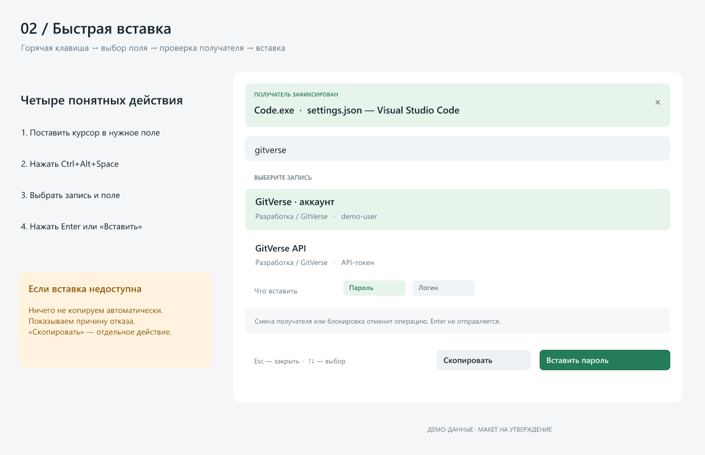
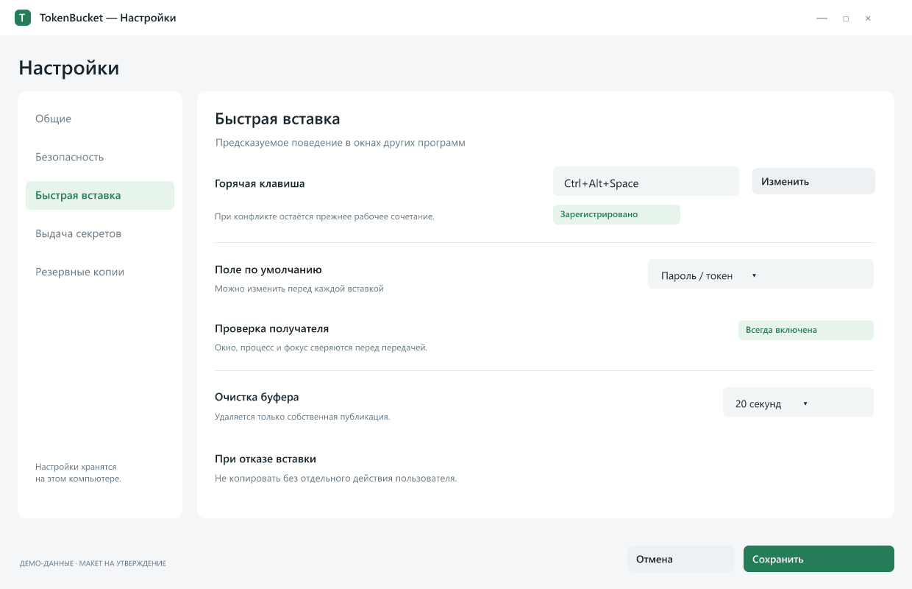

# TokenBucket: предложение по улучшениям

Дата: 2026-10-22. Вариант B, три макета и F1–F5 утверждены пользователем 2026-10-23. Спецификация первого этапа: [рабочая быстрая вставка](2026-10-23-quick-paste-design.md). Реализация следует после рассмотрения спецификации и плана.

## Цель и границы

Сделать существующий локальный менеджер секретов удобным для ежедневной работы: надёжно вставлять секрет в поле другого приложения по горячей клавише, понятно управлять записями и настройками, сохранять контроль над выдачей данных.

Подтверждённый пользователем симптом: по горячей клавише открывается окно быстрой вставки и остаётся открытым, ожидаемой вставки нет. Конкретные приложения-получатели пока не названы. Windows — основной текущий объём; Linux остаётся отложенным согласно RESUME.MD. Используем существующие Qt Widgets, libsodium, формат хранилища и зелёный акцент. Облачные сервисы для обработки секретов не добавляем.

Основания: текущие исходники на коммите 02e1a7f, RESUME.MD, спецификация v1 §6, план Task 13, SDD ledger, историческая оценка защиты от 2026-10-20 и граф .engram/. Исторические результаты тестов не считаются проверками этой работы.

## Варианты

| Вариант | Объём | Компромисс |
| --- | --- | --- |
| A. Точечное исправление | Только рабочая панель вставки, проверки получателя и регрессионные тесты | Самый короткий путь; организация интерфейса остаётся прежней |
| B. Поэтапное улучшение — рекомендуется | Сначала A; затем три макета, единые настройки и выбранные функции управления | Каждый этап можно проверить и принять отдельно; сохраняем стек и данные |
| C. Одновременная полная переработка | Новая организация интерфейса, настроек, выдачи и управления данными за один этап | Больше взаимозависимых изменений и риск регрессий; не рекомендуется |

## Подтверждённые по исходникам проблемы

Это статический разбор. Запуск текущей программы и воспроизведение через реальный буфер в этой работе не выполнялись.

| Код | Наблюдение | Основание |
| --- | --- | --- |
| QP-1 | Перед скрытием панели проверяется, что foreground — исходное окно. При нормальном взаимодействии foreground уже сама панель; отправка отменяется до восстановления получателя | MiniPanel.cpp:50,83–88; quickpaste_win.cpp:31–32 |
| QP-2 | Нет явной кнопки вставки, подсказок клавиатуры и обработчика Esc; только Return-shortcut и двойной щелчок | MiniPanel.cpp:17–30 |
| QP-3 | Панель не подписана на stateChanged: блокировка запрещает отправку, но не закрывает панель и не очищает список метаданных | MiniPanel.cpp:17–39,55 |
| QP-4 | При смене hotkey сначала снимается старое сочетание; новое сохраняется до успешной регистрации. При конфликте рабочее сочетание можно потерять | MainWindow.cpp:789–809; quickpaste_win.cpp:66–78 |
| QP-5 | Qt::Key напрямую преобразуется в Win32 virtual key. Для специальных клавиш эти пространства кодов различаются; произвольные сочетания нельзя считать поддержанными | quickpaste_win.cpp:88–97 |
| QP-6 | Секрет публикуется в буфер до проверки получателя. Отмена вставки уже меняет буфер и оставляет секрет доступным до таймера | MiniPanel.cpp:74–85 |
| QP-7 | Идентичность получателя ограничена HWND; повышенные права предполагаются по неудаче чтения имени процесса, без проверки уровней целостности | QuickPaste.h:15; quickpaste_win.cpp:12–32; MiniPanel.cpp:79 |
| QP-8 | E2E проверяет прямой sendCtrlV, обходя горячую клавишу, панель, выбор записи и возврат фокуса; при проблеме фокуса тест пропускается | tests/test_e2e.cpp:259–271 |

Дополнительные гипотезы для проверки: состояние удерживаемых Ctrl/Alt/Shift/Win при SendInput; маршрутизация WM_HOTKEY через windows_generic_MSG/windows_dispatcher_MSG; поведение получателя после диалога повторной проверки. Гипотезы не выдаются за воспроизведённые причины пользовательского сбоя.

Документация Qt: https://doc.qt.io/qt-6/qabstractnativeeventfilter.html

Документация Windows: https://learn.microsoft.com/en-us/windows/win32/api/winuser/nf-winuser-sendinput и https://learn.microsoft.com/en-us/windows/win32/api/winuser/nf-winuser-setforegroundwindow

## Этап 1. Рабочая быстрая вставка — приоритет P0

### Поведение

1. Пользователь ставит курсор в поле другого приложения и нажимает глобальную горячую клавишу.
2. До показа панели фиксируются окно и идентичность процесса-получателя. Панель показывает процесс и заголовок; полные секреты не отображаются.
3. Пользователь выбирает запись и поле. Для учётных данных доступны логин и пароль, для API-записи — токен. Изначально выбран пароль/токен. Многострочные секреты и SSH-ключи не допускаются к автоматической вставке.
4. Enter из поиска или списка и явная кнопка выполняют одно действие. Стрелки перемещают выбор; Esc, крестик и повторный вызов закрывают панель. Нет подходящих записей — понятное пустое состояние.
5. Для reverify подтверждение привязано к записи, полю, получателю и поколению разблокировки. После диалога запись перечитывается; лишние копии секретов до проверки не создаются.
6. До возврата фокуса проверяется существование и идентичность получателя; собственная панель не считается чужим получателем. Реальное переключение пользователем на постороннее окно отменяет операцию.
7. Панель скрывается, исходное окно активируется. С ограниченным ожиданием проверяются фактический фокус и уровни целостности. Отказ активации не обходится отключением защит Windows.
8. Непосредственно перед публикацией и отправкой сверяются получатель, состояние приложения и запись. Не отправляются события при удерживаемых конфликтующих модификаторах; ожидание ограничено по времени и допускает отмену.
9. Секрет публикуется существующим ClipboardGuard и передаётся Ctrl+V. Enter в окно-получатель никогда не отправляется. Успех SendInput означает передачу событий, а не доказательство принятия секрета приложением.
10. Отказ до публикации оставляет буфер неизменным. Если события не отправлены после публикации, собственная публикация удаляется безопасным существующим механизмом, без удаления более нового чужого содержимого. При частичной отправке сообщается неопределённый результат, автоматического повтора нет. Ручное копирование — отдельная явная кнопка.

На блокировке, смене хранилища и закрытии панели очищаются список, выбор и контекст операции. Действия не могут продолжиться после нового поколения разблокировки. Сообщения об ошибках объясняют причину: нет выбора, получатель исчез, фокус не возвращён, повышенные права, конфликт клавиши, занятый буфер, отмена проверки. Отказ не выглядит как молчание.

### Настройка сочетания

Одно сочетание, без последовательностей из нескольких аккордов. Поддерживаемые клавиши явно преобразуются в Win32 VK; неподдерживаемые отклоняются. Повтор клавиши не открывает несколько панелей. Новое сочетание сначала проверяется/регистрируется; только после успеха становится сохранённым. При конфликте остаётся прежнее рабочее сочетание.

### Объём кода

MiniPanel.cpp/.h, QuickPaste.h, QuickPasteWin.h, quickpaste_win.cpp, обработчик changeHotkey в MainWindow.cpp, tests/test_paste_win.cpp, tests/test_e2e.cpp. ClipboardGuard меняется только если для безопасного снятия собственной публикации не хватает существующего контракта. Переиспользуются Application::generation, VerifyDialog и существующие правила выдачи; новая универсальная система автоматизации не вводится.

### Критерии приёмки

- Полный маршрут: горячая клавиша → панель → выбор → возвращение в исходное поле → точное значение. Путь через панель обязателен в регрессионном тесте.
- Мышь, клавиатура, главное окно в трее, светлая/тёмная тема, пустой поиск, отмена и повторный вызов.
- Смена/закрытие получателя, блокировка во время проверки, конфликт hotkey, неподдерживаемая клавиша, удерживаемые модификаторы, отказ буфера и частичная отправка.
- На целевой интерактивной Windows-машине полный маршрут не может быть зачтён как успешный при QSKIP. В неинтерактивной среде пропуск явно считается отсутствием проверки.
- Контрольные приложения: Блокнот, редактор кода и поле браузера. Для терминала поддержка Ctrl+V проверяется отдельно; универсальная совместимость не обещается. Для повышенных окон — безопасный отказ без автоповышения прав.
- Тестовая среда использует выделенное окно и вымышленные секреты. Перед испытаниями с системным буфером требуется отдельное согласование его замены/очистки. В этой подготовке буфер не изменялся.

## Этап 2. Дизайн и управление — приоритет P1

Макеты — демонстрационные, не скриншоты работающей версии. Данные вымышлены. Пропорции, отступы и иерархия предлагаются для утверждения; существующий щит-логотип сохраняется, знак T в заголовках служит условным маркером.

### Главное окно

- Сохраняем три области: навигация, список, карточка. Настраиваемые разделители и восстановление размеров окна.
- В навигации: все записи, избранное, истекающие; ниже проекты и группы. Это представления существующих данных.
- Один заметный поиск, дополнительные фильтры компактны. Ctrl+K переводит фокус в поиск. Поиск и список не отображают секретные значения.
- Карточка отделяет метаданные от закрытого секрета; подписи «Копировать», «Показать», «Дополнительно» однозначны. Действия с SSH и окружением остаются доступными по соответствующему типу.
- Строка состояния показывает блокировку и остаток таймера, состояние собственной публикации в буфере и реальное сочетание быстрой вставки.
- Реальные элементы Qt с именами для скринридера, видимым фокусом и полным управлением клавиатурой; состояние различается текстом, а не только цветом. Проверка DPI 100/150/200%, ширины от 960 px и обеих тем.

### Панель вставки

Получатель, поиск, выбранная запись, поле и основное действие видны одновременно. Скрытые/заблокированные/недоступные состояния имеют отдельные подписи. В этапе 1 внедряется минимальная рабочая компоновка; визуальная полировка относится к этапу 2.

### Единое окно настроек

- Общие: тема, автозапуск, уведомления, сворачивание в трей; текущие значения сохраняются при обновлении.
- Безопасность: автоблокировка, показ секрета, таймер буфера, объяснение границ Hello/DPAPI. Проверки получателя не отключаются настройкой.
- Быстрая вставка: сочетание и статус регистрации, выбор поля по умолчанию, понятные ограничения Windows.
- Выдача секретов: текущие режимы окружения и политика очистки; предупреждения о незашифрованном хранении остаются обязательными.
- Резервные копии: состояние существующей .bak, дата, расположение и отдельная процедура восстановления с проверкой контейнера и сохранением текущего файла перед заменой.
- Неприменённые изменения можно отменить. Ошибка одной настройки не выдаётся за успешное сохранение. Значения таймеров ограничены: очистка буфера 10/20/30/60 секунд (по умолчанию 20), показ секрета 5/10/15/30 секунд (по умолчанию 15); автоблокировка сохраняет текущие 1–60 минут.

## Этап 3. Дополнительный функционал — утверждается выборочно

| Код | Предложение | Зачем и ограничение |
| --- | --- | --- |
| F1 | Параметры существующего генератора: длина и допустимые группы символов | Поддержать требования сайтов; сохранить криптографический RNG и запрет пустого алфавита |
| F2 | Массовое перемещение записей и изменение тегов | Управление большим хранилищем; одно атомарное сохранение, подтверждение удаления |
| F3 | Сохранённые представления по типу, тегам и срокам | Быстрый доступ к рабочим наборам; без дублирования записей |
| F4 | Управление существующей резервной копией и проверяемое восстановление | Доступная пользователю защита от ошибок; не заменяет независимую резервную копию |
| F5 | Настраиваемое поведение закрытия окна | Явный выбор «свернуть», «заблокировать и свернуть», «выйти»; по умолчанию сохранить нынешнее поведение |

F4 пересекается с разделом настроек и реализуется один раз. Парольный генератор, теги, избранное, срок действия, импорт и шифрованный экспорт уже существуют: предлагается развивать их управление, а не создавать заново.

TOTP, история прежних значений секретов, синхронизация, расширение браузера и командные права доступа в этот объём не входят: это самостоятельные возможности с изменением данных и модели угроз.

## Защита: обязательные изменения и отдельный резерв

### Вместе с этапами 1–2

- Исправить QP-1…QP-8 и проверять гипотезы только по наблюдаемым результатам. Получатель определяется по идентичности окна и процесса; права проверяются через токены/уровни целостности, а не по отображаемому имени.
- Отмена до публикации не меняет буфер. После публикации очищается только собственное содержимое; чужие новые данные сохраняются. Старый пользовательский буфер автоматически не восстанавливается.
- Подтверждение выдачи относится к конкретному действию. Контекст и метаданные панели очищаются при блокировке; полного гарантированного стирания всех Qt-копий в памяти не обещаем.
- Секреты не попадают в журналы, заголовки окон, параметры командной строки, список результатов поиска или макеты. Диагностика — этап операции, безопасный код причины и результат, без значения секрета.
- Шифрование контейнера, проверка KDF, атомарное сохранение, права файлов, история/синхронизация буфера и защита от дампов не ослабляются ради удобства.
- Историческая оценка от 2026-10-20 обновляется после фактической проверки. Формулировку об устранённой TOCTOU нельзя считать атомарной гарантией: SendInput направляет ввод в активное окно и сохраняет остаточную гонку.

### Отдельное решение после основной работы

- Собственный защищённый CBOR-декодер: путь чтения сейчас использует обычную память Qt; потребует отдельной спецификации и проверки повреждённых контейнеров.
- Изменение модели Hello: текущий DPAPI-режим не защищает от произвольного процесса той же скомпрометированной учётной записи. Усиление требует иной модели защиты ключа, отдельного решения и миграции.
- Подпись Windows-пакета и закреплённая процедура выпуска: полезны для доверия к дистрибутиву; выпуск и операции с сертификатами согласуются отдельно.

## Навыки и инструменты для этой работы

| Средство | Статус и применение |
| --- | --- |
| brainstorming | Применён: границы, варианты, макеты, утверждение проекта до реализации |
| ponytail ultra | Применён: сохраняем стек, существующие компоненты и минимальный достаточный объём |
| graphify / Engram CLI | Применён: существующий граф и проверка связей в исходниках; граф неполон, не заменяет источник |
| systematic-debugging | Применён к диагностике: различаем причину в исходниках, гипотезы и непроверенные сценарии |
| security-and-hardening | Применён к обзору границ выдачи и рисков; новый полный аудит не заявлен |
| find-skills / plugin-management | Проверены существующий набор и каталог; лишние расширения не установлены |
| computer-use | Подключён штатный @oai/sky через Node REPL; перечисление окон работает, открытое окно TokenBucket не найдено |
| FigCraft MCP | Проверен, макеты созданы и экспортированы; доступен редактируемый источник .figcraft |
| PowerShell / RTK / Qt Test / CTest | Доступные средства локального анализа и будущей проверки; тесты в этой подготовке не запускались |
| GitVerse MCP | Инструменты доступны в сессии; предназначены для проверки PR/CI после реализации; публикация не входит в согласование дизайна |

При переходе к коду нужны test-driven-development, source-driven-development, verification-before-completion и code-review-and-quality. Они применяются на соответствующем этапе, а не заменяют утверждение требований. Web-ориентированные React/Vitest/Playwright-навыки не подходят для проверки Qt Widgets; дополнительные MCP для графики не требуются, поскольку FigCraft уже доступен. Доступность инструмента не означает разрешение передавать ему секреты.

## Что именно предлагается утвердить

1. Вариант B и порядок: рабочая вставка → дизайн/настройки → выбранные F1–F5.
2. Три макета и сохранение существующего Qt Widgets/брендинга; обсуждается компоновка, а не смена технологии.
3. Отказ без автоматического копирования; отдельные «Вставить» и «Скопировать»; без Enter и автоповышения прав.
4. Набор дополнительных возможностей F1–F5 — можно исключить любые пункты.
5. Усиление CBOR/Hello и подпись пакета остаются отдельными задачами.

Утверждение этого предложения позволяет подготовить конкретную спецификацию первого этапа. Далее отдельно рассматриваются написанная спецификация, план реализации и способ выполнения. Коммиты реализации, публикация, push, выпуск пакета и изменение системного буфера не подразумеваются общим согласием с макетами.
