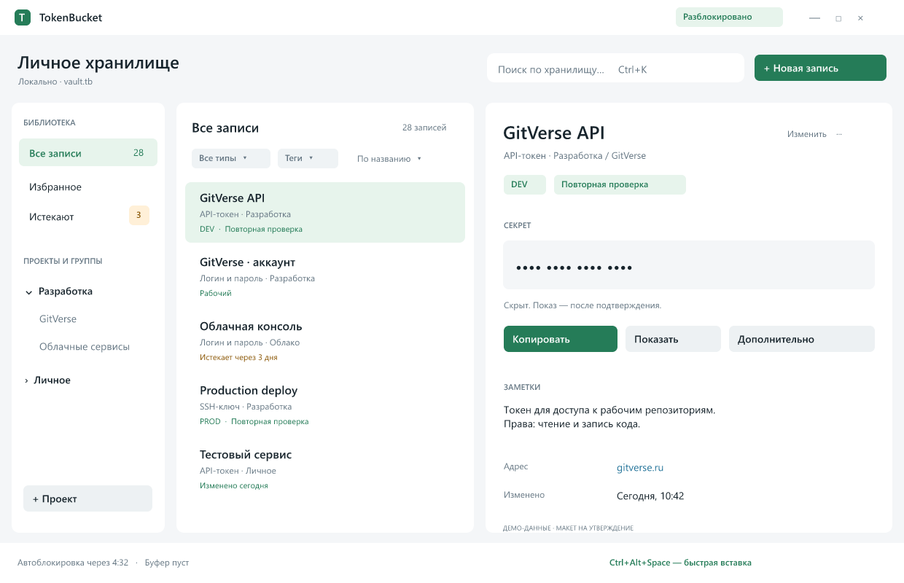

# TokenBucket — этап 2а: главное окно

Дата: 2026-10-23. Статус: утверждено пользователем 2026-10-23; план реализации подготовлен отдельно для рассмотрения. Реализации этого этапа нет.

Основание: утверждённый вариант B, макет главного окна и порядок этапов из [предложения](2026-10-22-tokenbucket-improvements-proposal.md). Этап быстрой вставки завершён в ветке `codex/quick-paste-implementation`; исходная точка следующего этапа — `a42f2c8`. Последняя проверка этой точки: Release и CTest 17/17, без ошибок и пропусков. Эти результаты не считаются проверками будущих изменений.

## 1. Результат и границы

Пользователь быстро находит запись во всём хранилище, отличает одноимённые записи и видит понятные действия с выбранным секретом. Главное окно следует утверждённой компоновке: библиотека слева, список посередине, карточка справа; поиск и создание записи сверху, состояния снизу.

Макет задаёт иерархию и зелёный акцент; демонстрационные названия, числа и времена заменяются реальными данными. Используются обычные Qt Widgets, системная рамка окна и существующие меню. Новые зависимости, изменения контейнера, криптографии и миграция данных не нужны.

В этот этап входят навигация, фильтрация, представление списка/карточки, сохранение геометрии, клавиатура и достоверные индикаторы. Единое окно настроек, настройка сроков показа/буфера, восстановление `.bak`, генератор, массовые операции, сохранённые пользовательские представления и варианты закрытия относятся к следующим этапам. Нынешнее закрытие в трей сохраняется. Изменения MiniPanel ограничены общим оформлением темы; её проверенный протокол выдачи не меняется.

## 2. Проверенная основа

| Участок | Сейчас | Изменение |
|---|---|---|
| MainWindow | QSplitter, дерево, QListWidget, карточка, существующие QAction | Перекомпоновка с сохранением контроллеров действий |
| refillList | Группа без поиска; глобальный поиск при непустом запросе; тип/теги/срок/сортировка | Добавить библиотечные представления и явное описание области поиска |
| EntryEditDialog | Уже содержит выбор проекта/группы; addEntry требует выбранный узел | Разрешить создание из библиотечного представления с явным выбором назначения |
| EntryCard | Повторная проверка, 15 секунд показа, раздельные действия для типов | Разделить визуальные блоки без обхода authorize/copyField |
| IdleTimer | Один настоящий таймер в main; чтения остатка нет | Добавить только чтение остатка, привязать его к индикатору окна |
| ClipboardGuard | Единый владелец копирования в MainWindow и MiniPanel | Добавить безопасный снимок состояния своей публикации |

Основания подтверждены в `MainWindow.cpp` (конструктор, refreshAll/refillList/addEntry), `EntryCard.cpp`, `EntryEditDialog.cpp`, `IdleTimer.*`, `ClipboardGuard.*` и связях `main.cpp`. Граф Engram использован для навигации; исходники имеют приоритет.

## 3. Главное окно и навигация

- Слева отдельные кнопки «Все записи», «Избранное», «Истекают» и существующее дерево проектов/групп. Библиотечные элементы не получают фиктивные UUID и не выдаются за узлы модели. После запуска выбраны «Все записи».
- «Все записи» показывает записи всех групп; «Избранное» — существующий флаг favorite; «Истекают» — сокращённый путь к существующему фильтру ближайших 30 дней. Это представления, без копирования записей и без изменения файла.
- Выбор библиотечного раздела снимает выделение дерева. Выбор настоящей группы отменяет библиотечный раздел. Действия над проектом/группой доступны только для реального выбранного узла; недопустимое действие объясняет, что нужно выбрать.
- Переход в «Все записи», «Избранное» или группу сбрасывает только фильтр срока в «Любой срок»; переход в «Истекают» устанавливает существующий режим «Истекают (30 дн.)». Тип, выбранные теги, сортировка и текст поиска сохраняются. Ручная смена срока из «Истекают» переводит в «Все записи» и сохраняет выбранный срок.
- Счётчики библиотечных разделов относятся ко всему хранилищу, не к текущему запросу. Список отдельно показывает «Показано N из M» с учётом активных фильтров. Смена суток обновляет сроки при очередном обновлении интерфейса, без сохранения модели.
- Новая запись из группы получает эту группу. Из библиотечного раздела открывается существующий редактор с незаполненным выбором назначения; сохранение требует явного выбора существующей группы/проекта. При отсутствии узлов предлагается создать проект. Отмена ничего не записывает.
- Перемещение дерева и существующие операции удаления/редактирования сохраняют свои проверки, подтверждения и точечный откат при ошибке сохранения.

## 4. Поиск, фильтры и список

Поиск остаётся глобальным, как в текущей реализации: при непустом запросе ищет по существующим несекретным полям во всём хранилище. Заголовок явно меняется на «Поиск по всему хранилищу»; выбранный проект не выдаётся за границу поиска. «Избранное» и активные тип/теги/срок дополнительно ограничивают результаты. Теги сохраняют семантику И, существующие правила сроков и сортировки не переписываются.

Список показывает название, тип, путь группы и компактные признаки избранного, повторной проверки и срока. Полные токен, пароль, приватный ключ и фраза не попадают в строки, подсказки или accessibility-описания. Выбор хранится по UUID, не по отображаемому тексту. Одноимённые записи различаются типом и путём. Типовые состояния: пустое хранилище; пустая группа; нет результатов с активными фильтрами; нет избранных; нет истекающих.

Обновление сохраняет выбранный UUID, пока запись остаётся в результате. Иначе скрывает прежний секрет и выбирает первую доступную запись либо показывает пустое состояние. Действия никогда не продолжаются над невидимым старым выбором. Для большого списка используются стандартные элементы/делегат Qt; отдельный QWidget на каждую из 10 000 записей не создаётся.

Ctrl+K переводит фокус в поиск и выделяет запрос; существующий Ctrl+F остаётся. Esc в поиске очищает запрос, в диалоге — отменяет диалог; Esc не превращается в глобальное удаление/выход. Стрелки, Tab/Shift+Tab, Enter и контекстные действия доступны с клавиатуры. Существующие горячие клавиши и QAction переиспользуются, без конкурирующих дубликатов.

## 5. Карточка и оформление

Карточка отделяет заголовок/тип/путь/признаки, закрытый секрет, действия и метаданные. До подтверждённого показа вместо секрета постоянная маска, длина которой не зависит от значения. Логин reverify-записи не раскрывается новым декоративным блоком в обход существующей проверки.

Основное действие подписано по типу: «Копировать токен», «Копировать пароль», «Копировать приватный ключ». Для учётных данных остаётся отдельное копирование логина. «Показать на 15 секунд» использует прежний таймер и authorize; смена записи, lock и клик вне карточки скрывают значение. Для SSH остаются существующие действия с фразой и сохранением файла; показа приватного ключа новая карточка не добавляет. «Изменить» и «Дополнительно» направляются в существующие проверяемые действия MainWindow.

Fusion и палитры сохраняются. Зелёный акцент используется последовательно для выбора и основного действия; состояния ошибки, предупреждения и блокировки имеют текст. Светлая и тёмная темы проверяются нативно. Видимый фокус, accessibleName, контраст и доступность кнопок не заменяются декоративными картинками. URL/заметки/имена отображаются как обычный текст; изменения оформления не добавляют автоматического открытия ссылок или внешних запросов.

## 6. Строка состояния без догадок

| Индикатор | Источник и правила |
|---|---|
| Блокировка/занятость | Фактические Gate и busy приложения; после lock очищаются метаданные |
| Остаток автоблокировки | Только настоящий IdleTimer из main; чтение не вызывает poke и не перезапускает отсчёт |
| Своя публикация | Только состояние ClipboardGuard: нет своей публикации / до очистки N с / очистка ожидает освобождения буфера |
| Сочетание вставки | Фактически зарегистрированное QuickPaste::sequence; при отсутствии регистрации — «не зарегистрировано» |

Для IdleTimer добавляется const-чтение остатка в миллисекундах, с отдельным значением «неактивен». MainWindow получает необязательную привязку к уже существующему таймеру; без привязки показывает отсутствие данных, а не выдуманные пять минут. Один UI-таймер не чаще раза в секунду обновляет текст; он не управляет защитным таймером. Сворачивание не останавливает автоблокировку.

Этот тик не вызывает refreshAll/showEntry, не меняет выделение и не скрывает показанный секрет раньше его собственного таймера. Пересчёт сроков при смене суток обновляет только необходимые представления; обычная перерисовка не считается активностью пользователя.

ClipboardGuard предоставляет один const-снимок только метаданных: владение текущей публикацией, ожидание очистки и остаток её таймера. На Windows владение сверяется по sequence и owner без OpenClipboard и без чтения содержимого. Отсутствие нашей публикации не означает пустой системный буфер. Не добавляются история, восстановление старого буфера или запись содержимого в настройки. Старые ограничения очистки и защита чужой новой публикации сохраняются; ожидание повторной очистки нельзя показывать как уже выполненную очистку.

Снимок справочный и может устареть к следующему тику; он не заменяет проверки безопасности при выдаче или очистке.

## 7. Размеры и сохранение

Три панели настраиваются QSplitter, с разумными минимальными ширинами и запретом случайного схлопывания. Начальное окно ориентируется на макет 1240×800, но ограничивается доступной областью экрана. Контрольная ширина — от 960 логических пикселей; меньше этого заголовок/фильтры компактно переносятся. Нынешняя карточка-диалог при ширине менее 720 сохраняется как совместимость, без отдельного мобильного интерфейса.

Сохраняются только геометрия окна и состояние разделителей, в новых ключах `ui/mainGeometry` и `ui/mainSplitter`. Запрос, выбранный UUID, названия групп/тегов и раскрытый секрет не записываются в QSettings. Некорректное состояние или отсутствующий монитор дают безопасную начальную компоновку в доступном экране. При ошибке записи настроек текущая работа продолжается, пользователь получает сообщение, что положение окна не сохранено; файл хранилища не меняется. Тесты используют временный INI и восстанавливают затронутые пользовательские настройки.

## 8. Проверки и границы приёмки

1. Пустое хранилище, несколько проектов/вложенных групп, одноимённые записи всех типов; Все/Избранное/Истекают и их реальные счётчики. Комбинации запроса, типа, тегов И, срока и сортировки, включая нулевой результат.
2. Переходы навигации и сохранение UUID; удаление/перемещение выбранной записи; создание из группы и из библиотеки, отсутствие назначения, отмена и ошибка сохранения. Операции над группой не принимают библиотечный раздел за узел.
3. Закрытая/показанная/reverify/SSH-карточка; lock во время подтверждения, смена записи и истечение 15 секунд. В списках и настройках нет полных секретов, скрытие старого выбора обязательно.
4. Реальный остаток IdleTimer: poke от пользователя, смена интервала, неактивное состояние, скрытое окно. Чтение и обновление UI не продлевают сеанс.
5. Своя/чужая/истёкшая публикация, занятый буфер и повторная очистка. Без изоляции или явного разрешения буфер не изменяется; разрешение предыдущего этапа не расширяется на реальные секреты.
6. Геометрия и splitter во временном INI: сохранение/восстановление, повреждённые данные, пропавший монитор, отказ записи. Старые настройки совместимы.
7. Нативные светлая/тёмная темы; 960/1240+ логических px, масштаб 100/150/200%; клавиатура, видимый фокус и читаемые состояния. Проверка геометрии не выдаётся за тест смены DPI между мониторами.
8. Полный Release и все прежние CTest-цели, включая внешний маршрут вставки и native-theme, без удаления/пропуска регрессий ради зелёного результата. Старые UI-тесты адаптируются к утверждённому новому стартовому представлению; проверки сохранения, выдачи и защиты сохраняются.

Последующие изменения выполняются в текущем изолированном checkout. Исходная ветка, установленная версия, пакет и удалённый репозиторий не обновляются этим согласованием. Реальный Hello, повышенное окно, терминал и отдельный редактор не объявляются проверенными без соответствующего запуска; действующий запрет Computer Use на Windows Terminal не обходится.

## Решение для утверждения

Утвердить этап 2а в этих границах: главное окно по макету, библиотечные представления, явное назначение новой записи, карточка, достоверные состояния и геометрия. После утверждения этой написанной спецификации составляется отдельный план реализации; выполнение — нативно в текущем checkout, как ранее, если пользователь не выберет иначе. Общее окно настроек и F1–F5 не подмешиваются в этот этап.
